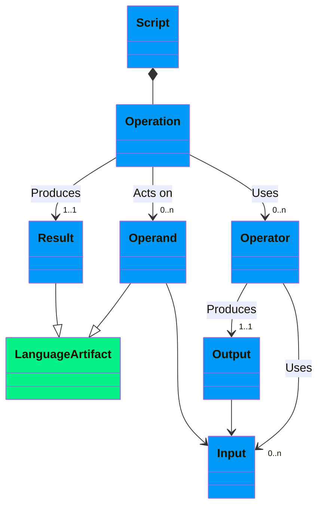
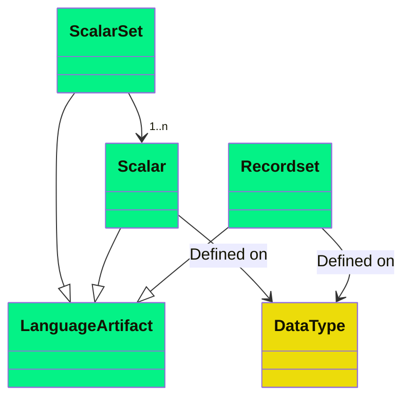
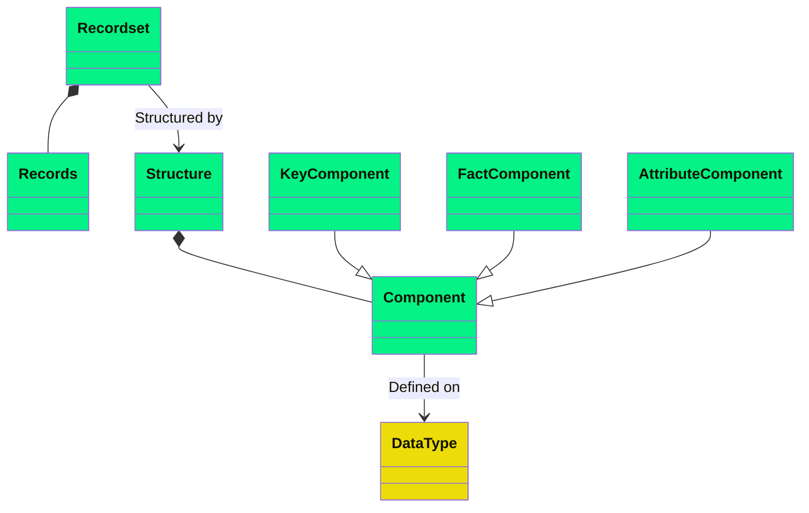
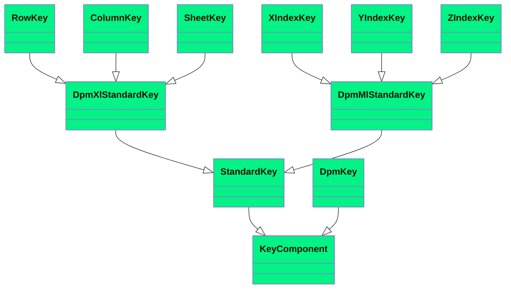
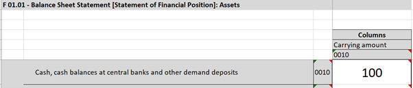
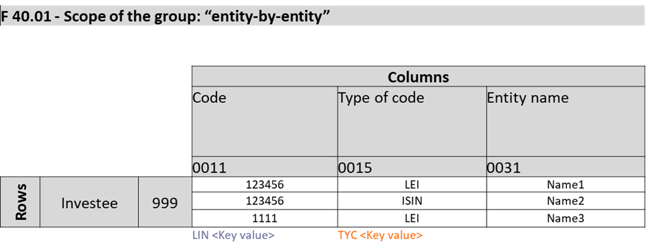
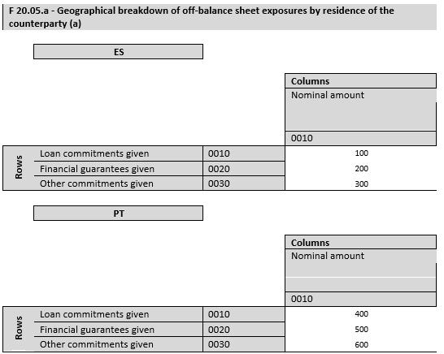

# 2 Information Model

## 2.1 Operations



The DPM *Operations* serve to write *Scripts*, which are computer programs that constitute a run-time and are composed of *Operations*.

*Operations* are expressions that use input *Operands* and/or *Operators* to produce a result.

Expressions are finite combinations of symbols that are well-formed according to the syntactical rules of the language. Expressions compose some *Operands* in a certain order by means of the *Operators* of the language, to obtain the desired result. The symbols of the expression designate *Operators*, *Operands*, and the order of application of the *Operators*.

*Operators* specify a type of operation to be performed on some input *Operands* (exceptionally, there may be *Operators* that do not take *Operands* as input, e.g., an *Operator* to get the current time) to generate an output. The output produced by one *Operator* may be used as input for another *Operator* (i.e., *Operators* can be nested).

*Operands* are specific artifacts from the DPM Expression Language referenced in an expression as input.

The result produced by an *Operation* is also a specific artifact from the DPM Expression Language.

## 2.2 Language Artifacts



DPM Expression Language calculations can operate on and generate as results three different types of *Artifacts*.

### 2.2.1 Scalars

*Scalars* are individual values of a certain *Data Type*.

### 2.2.2 Scalar Sets

*Scalar Sets* are sets of *Scalar* values defined on the same *Data Type*. *Scalar Sets* are typically used with the in operator.

### 2.2.3 Recordsets



*Recordsets* are collections of *Records* that share a same *Structure*. Technically, *Recordsets* are two-dimensional labelled data structures (tabular), which can be assimilated to Relational Tables or Data Frames. The columns (fields) of the *Recordset* are provided by the *Components* of its *Structure*. The rows of the *Recordset* are its composing *Records*.

The *Structure* of the *Recordset* is a collection of *Components*, which can have one of three roles: *Key*, *Fact* or *Attribute*. Each *Component* has a name, which must be unique within the *Recordset*. *Key*, *Fact* and *Attribute Components* are each defined on a single *Data Type*. For *Fact Components*, the *Data Type* is determined by the *Data Type* of the selected *Variables*, as described in §2.2.3.2.

Each *Record* of the *Recordset* is individually identified by the combination of the values for its *Key Components*.

A *Recordset* having no *Key Components* behaves like a *Scalar*.

A *Recordset* may have no records.

#### 2.2.3.1 Key Components



*Key Components* may be *Standard* or *DPM*. *Standard Key Components* are different for DPM-ML and DPM-XL, although their behaviour is the same.

*Standard Key Components* are common to all the *Recordsets*, independently on how the *Variables* are defined in the DPM. For each *Recordset*, there may be 0 or 1 occurrence of each subtype of *Standard Key Component*.

##### 2.2.3.1.1 Standard DPM-XL Key Components

- **Row Key**: Identifies the Row Ordinate from a Report Table where the selected *Variable* is located. Arises in *Variable Set* Selections, when more than one Row for one Report Table is selected. The name for the *Component* is "r". It is defined on the String *Data Type*.
- **Column Key**: Identifies the Column Ordinate from a Report Table where the selected *Variable* is located. Arises in *Variable Set* Selections, when more than one Column for one Report Table is selected. The name for the *Component* is "c". It is defined on the String *Data Type*.
- **Sheet Key**: Identifies the Sheet Ordinate from a Report Table where the selected *Variable* is located. Arises in *Variable Set* Selections, when more than one Sheet for one Report Table is selected. The name for the *Component* is "s". It is defined on the String *Data Type*.

##### 2.2.3.1.2 Standard DPM-ML Key Components

Regarding the DPM-ML, the *Standard Components* are three indexes, which do not represent any DPM object. They just serve to make sure that the right *Variables* are matched together when used with an *Operator*. The names for these *Components* are "x", "y" and "z". Note that these indexes do not necessarily correspond to rows, columns, and sheets. During the conversion from DPM-XL, the values of the indexes for each *Variable* shall be provided according to algorithms.

##### 2.2.3.1.3 DPM Key Components

*DPM Key Components* are specific to how data is defined in the DPM. Arise when Open *Variables* are selected, and a *Recordset* will have one *DPM Key Component* per each *Key Variable* associated to the selected *Variables*.

The name for the *DPM Key Components* is the Code of the Property associated to the DPM *Key Variable*.

##### 2.2.3.1.4 Contextual Key Components

There are two contextual dimensions that are always latent in every *Recordset*:

- **refPeriod**: Identifies the reference period of the data. It is defined on the *Date* *Data Type*.
- **entityID**: Identifies the reporting entity. It is defined on the *String* *Data Type*.

At compile-time, refPeriod and entityID are assumed to always exist, so they can always be referenced in expressions (e.g., as the `var` parameter in `time_shift`). At runtime, whether they effectively act as *Key Components* depends on the input data: if the data contains multiple reference periods or entities, they become distinguishing dimensions in the *Recordset*.

A *Scalar* in DPM-XL is a *Recordset* with no *Key Components* other than the contextual ones. Within each instance (i.e., for each combination of refPeriod and entityID), it behaves as a single value. Therefore, "scalar" means "one value per instance", which is the only meaningful scope for a calculation.

#### 2.2.3.2 Fact Component

A *Recordset* has one mandatory, and only one, *Fact Component*. The name for the *Component* is "f". Its *Data Type* depends on the *Data Type* of the selected *Variables*.

When a selection includes *Variables* of the same *Data Type*, the *Fact Component* has that *Data Type*. When a selection includes *Variables* of different *Data Types*, the *Data Type* of the *Fact Component* is the maximum common *Data Type*, determined by applying implicit casting (see section 2.3.2). The implicit casting hierarchy is as follows:

- Integer → Number → String
- Date → String
- Boolean → String
- Item → String
- Subcategory → String

The maximum common *Data Type* is the most specific type to which all the selected *Variables* can be implicitly cast. For example, if a selection includes Integer and Number *Variables*, the *Fact Component* has *Data Type* Number. If a selection includes Number and Boolean *Variables*, the *Fact Component* has *Data Type* String.

Selections resulting in implicit casting to a common *Data Type* should raise a warning, as the casting may cause a loss of operational capability (e.g., a *Recordset* cast to String cannot be used with arithmetic *Operators*).

If a DPM *Key Variable* is selected, the resulting *Recordset* will have the values for that *Variable* in the *Fact Component*, on top of having them in their corresponding *Key Component*. See example in section 2.2.4.4.

#### 2.2.3.3 Attribute Components

*Attribute Components* provide additional information to the *Fact* value.

DPM *Attribute Components* are specific to how data is defined in the DPM. Arise when a *Variable* with associated *Attribute Variable* is selected. A *Recordset* will have one DPM *Attribute Component* per each Property or Metric associated to any *Attribute Variable* associated to the selected *Variables*.

The name for the DPM *Attribute Components* is the Code of the Property associated to the DPM *Attribute Variable*.

### 2.2.4 Examples

*Recordsets* arise from Open *Variable* selections or from selection of multiple *Variables*.

#### 2.2.4.1 Closed Variable Selection

For instance, taking as an example EBA's Table F 01.01:



```
{tF_01.01, r0010, c0010}
```

In the context of a single instance (i.e., disregarding the "refPeriod" and the "entityID"), selects a *Recordset* without *Key Components*, which works as a *Scalar* with value 100.

In the context of data with multiple dates and/or entities, and supposing that the data refer to the entity with code "id123" and to the date 31/12/2020, and that it has been reported with a 1 precision (attribute):

| entityID  {#k} | refPeriod {#k}| f {#f}| p {#a} |
|---------|----------|---|---|
| id123 | 2020-12-31 | 100 | 1 |

#### 2.2.4.2 Open Variable Selection



```
{tF_40.01, c0031}
```

Selects an Open *Variable*. In this illustrative example, yields a *Recordset* with three *Records*. The *Recordset*, in the context of a single instance, has two DPM *Key Components*, because the selected *Variable* (the one rendered in Column 0031 of Report Table F 40.01) is associated in the DPM to a *Key* with two *Key Variables*. These *Key Variables* are associated to Properties with codes "LIN" (rendered in Column 0011) and "TYC" (rendered in Column 0015).

The following table represents the *Recordset*:

| LIN {#k} | TYC {#k}| f {#f}|
|-----|-----|---|
| 123456 | LEI | Name 1 |
| 123456 | ISIN | Name 2 |
| 1111 | LEI | Name 3 |

#### 2.2.4.3 Variable Set Selection



```
{tF_20.05, r0020-0030, c0010}
```

This case selects a set of *Variables* because the selection includes more than one Row. This implies that the *Row Key Component* applies to this *Recordset*. Besides, the selected *Variables* are associated to a *Key* with a single *Key Variable*, which is associated to a property with code "RCP".

| RCP {#k}| r {#k}| f {#f}|
|-----|---|---|
| ES | 0020 | 200 |
| ES | 0030 | 300 |
| PT | 0020 | 500 |
| PT | 0030 | 600 |

In this case, the *Recordset* for the DPM-ML would be slightly different because of the change in the *Standard Key Component*. Instead of the row, we would have any of the three indexes. For instance, using the x index:

| RCP {#k}| x {#k}| f {#f}|
|-----|---|---|
| ES | 1 | 200 |
| ES | 2 | 300 |
| PT | 1 | 500 |
| PT | 2 | 600 |

Note that the important thing for DPM-ML to be consistent is that all the *Records* with the same row share the same index.

#### 2.2.4.4 Key Variable Selection


```
{tF_40.01, c0015}
```

Selects an Open *Key Variable*. The *Recordset*, in the context of a single instance, has two DPM *Key Components*, because the selected *Variable* (the one rendered in Column 0015 of Report Table F 40.01) is associated in the DPM to a *Key* with two *Key Variables* (in fact, it is part of the *Key*). These *Key Variables* are associated to Properties with codes "LIN" (rendered in Column 0011) and "TYC" (rendered in Column 0015).

The following table represents the *Recordset*:

| LIN {#k} | TYC {#k} | f {#f}|
|-----|-----|---|
| 123456 | LEI | LEI |
| 123456 | ISIN | ISIN |
| 1111 | LEI | LEI |

Note that the resulting *Recordset* has the values for the type of code two times, one as *Key Component* and another as *Fact Component*. This is necessary to allow doing calculations on the *Fact* while keeping all the *Records* in the *Recordset* uniquely identified.

## 2.3 Data Types

DPM *Operations* data types are defined with the principle: Create only a data type if they have different behaviour to other data types with at least one *Operator*.

The data types are:

- **String**: Sequence of alphanumeric characters of any length.
- **Number**: Is a rational number of any magnitude and precision, also used as approximation of a real number. Numbers can be treated as points or as intervals. Intervals are defined as a centre plus and minus a radius (c ± r). The centre is the input value provided. The radius is calculated based on the precision of the number as `10⁻ᵖ/2`. This specification does not mandate a specific representation standard for numbers. The choice of representation (e.g., IEEE 754 binary or decimal floating-point, arbitrary-precision decimals) is left to implementers, who should balance precision, performance, and the requirements of their technology stack.
  - **Integer**: Positive and negative integer numbers and zero. It Is a subtype of the type Number. As Number subtypes, Integers can be treated as intervals.
- **Date**: Represents a time reference following ISO 8601, written as a specific date (e.g., `#2022-01-15#`).
- **Boolean**: denotes a logical binary state, meaning either `true` or `false`.
- **Category items**: A reference to the code of a Category Item.

### 2.3.1 Correspondences with DPM Data Types

The DPM provides a wider list of data types. This is because greater granularity in the data typology may be useful for reporting or representation purposes (e.g., a monetary amount requires a currency attribute, while a pure number does not).

For each DPM data type there is one, and only one DPM-XL *Data type*.

| **Code** | **Name**                        | **DPM-XL type** |
| -------- | ------------------------------- | --------------- |
| i        | integer                         | Integer         |
| r        | decimal                         | Number          |
| s        | string (non empty)              | String          |
| b        | boolean                         | Boolean         |
| t        | true                            | Boolean         |
| dt       | date time                       | Date            |
| d        | date                            | Date            |
| e        | enumeration                     | Category Items  |
| m        | monetary                        | Number          |
| p        | percentage                      | Number          |
| u        | URI                             | String          |
| o        | ordinals                        | Integer         |
| es       | string (including empty string) | String          |

### 2.3.2 Casting

The casting between data types is possible. Casting can be done explicitly, if the cast *Operator* is used, or implicitly when it is allowed. The following table contains all the casting options.

|  | String | Number | Integer | Date | Boolean | Item | Subcategory |
|---|---|---|---|---|---|---|---|
| **String** | | Explicit | Explicit | Explicit | Explicit | Explicit | Explicit |
| **Number** | Implicit | | Explicit | Not possible | Not possible | Not possible | Not possible |
| **Integer** | Implicit | Implicit | | Not possible | Not possible | Not possible | Not possible |
| **Date** | Implicit | Not possible | Not possible | | Not possible | Not possible | Not possible |
| **Boolean** | Implicit | Not possible | Not possible | Not possible | | Not possible | Not possible |
| **Item** | Implicit | Not possible | Not possible | Not possible | Not possible | | Not possible |
| **Subcategory** | Implicit | Not possible | Not possible | Not possible | Not possible | Not possible | |

## 2.4 Language Conventions

### 2.4.1 Case Sensitivity

DPM-XL is case insensitive for keywords. The keywords listed in this specification (e.g., `if`, `then`, `sum`, `where`) can be written in any combination of upper and lower case.

Identifiers (table codes, property codes, operation names) are case insensitive: `CNT`, `cnt`, and `Cnt` refer to the same identifier.

### 2.4.2 Conventions to Write Scalars

To the effects of DPM-XL, when writing *Scalars*, the following conventions should be followed:

- **String**: Between double quotes ("this is a string") or single quotes ('this is also a string'). Empty strings are represented as "" or ''.
- **Number**: Sequence of numeric digits. Dot (".") shall be used to separate the decimal and the integer part.
  - **Integer**: Sequence of numeric digits.
- **Date**: Written between hashes (#), following ISO 8601 (e.g., #2021-11-25#).
- **Boolean**: true or false.
- **Items**: An item signature between square brackets, in the format [namespace:code]. E.g., [eba_RT:x11], [eba_CU:iso_currencies]. Item signatures are assumed to be unique within a given DPM release.

### 2.4.3 Reserved Words

The following words are reserved in DPM-XL and cannot be used as identifiers unless escaped:

**Logical operators:** `true`, `false`, `and`, `or`, `xor`, `not`

**Arithmetic and numeric operators:** `abs`, `exp`, `ln`, `sqrt`, `power`, `log`, `max`, `min`

**Aggregate operators:** `max_aggr`, `min_aggr`, `sum`, `count`, `avg`, `median`

**Comparison and set operators:** `match`, `isnull`, `in`

**Conditional operators:** `if`, `endif`, `then`, `else`, `nvl`, `filter`

**Clause operators:** `where`, `get`, `rename`, `to`, `sub`, `group by`

**Selection and assignment:** `with`, `null`

**Time operators:** `time_shift`

**String operators:** `len`

**Time period codes:** `A`, `S`, `Q`, `M`, `W`, `D`

**Contextual identifiers:** `refPeriod` and `entityID` are reserved identifiers with special meaning (see section 2.2.3.1.4). They cannot be used as regular property codes or operation names.

**Selection mode keywords:** `interval` and `default` are reserved within selection expressions (inside `{}`).

### 2.4.4 Escaping Reserved Words

If a DPM identifier (e.g., a property code or table code) conflicts with a reserved word, it can be escaped using backticks. For example, if a property is named `sum`, it can be referenced as `` `sum` `` to distinguish it from the `sum` operator.

Escaped identifiers are case sensitive: `` `Sum` `` and `` `sum` `` refer to different identifiers.