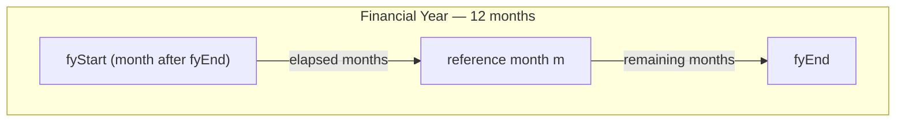

# 10 Time Operators

## 10.1 Time Shift

### 10.1.1 Syntax

> **time_shift(** op, period, numberPeriods, {var} **)**

### 10.1.2 Input Parameters

> op: rset <*> | scal <date\>

> period: time_period_code

> numberPeriods: scal <int\>

> var: scal <prop\>

where `time_period_code` is one of the following bare keyword tokens:

| Code | Period |
|------|--------|
| `A`  | Annual (year) |
| `S`  | Semi-annual (semester) |
| `Q`  | Quarterly |
| `M`  | Monthly |
| `W`  | Weekly |
| `D`  | Daily |

### 10.1.3 Output

> rset <*> | scal <date\>

### 10.1.4 Semantics
Changes the dates of the var *Component* of the *Recordset* op by adding (or subtracting) numberPeriods of the given period unit.

### 10.1.5 Additional Constraints

- If op is a *Recordset*, then

  - var must be provided,
  - must belong to the *Recordset* op, and
  - must be of *Date* type.

- If op is a *Scalar*, then var must be omitted.

### 10.1.6 Behaviour
Returns a *Recordset* with the same data structure and number of *Records* as the input op. The dates for the *Component* var are modified by adding the numberPeriods (subtracting, if negative) of the given period unit.

### 10.1.7 Examples
Considering the following *Recordset*, generated from the selection {tT1, r010-020, c010-020}:

| refPeriod {#k} | r {#k} | c {#k} | f {#f} |
|--------------|--------|--------|--------|
| 2022-01-01   | 010    | 010    | 100    |
| 2022-01-01   | 010    | 020    | 200    |
| 2022-01-01   | 010    | 010    | 300    |
| 2022-01-01   | 010    | 020    | 400    |
| 2022-04-01   | 020    | 010    | 500    |
| 2022-04-01   | 020    | 020    | 600    |
| 2022-04-01   | 020    | 010    | 700    |
| 2022-04-01   | 020    | 020    | 800    |

`time_shift({tT1, r010-020, c010-020}, Q, 1, refPeriod)` returns:

| refPeriod {#k} | r {#k} | c {#k} | f {#f} |
|--------------|--------|--------|--------|
| 2022-04-01   | 010    | 010    | 100    |
| 2022-04-01   | 010    | 020    | 200    |
| 2022-04-01   | 010    | 010    | 300    |
| 2022-04-01   | 010    | 020    | 400    |
| 2022-07-01   | 020    | 010    | 500    |
| 2022-07-01   | 020    | 020    | 600    |
| 2022-07-01   | 020    | 010    | 700    |
| 2022-07-01   | 020    | 020    | 800    |

`time_shift({tT1, r010-020, c010-020}, Q, -1, refPeriod)` returns:

| refPeriod {#k} | r {#k} | c {#k} | f {#f} |
|--------------|--------|--------|--------|
| 2021-10-01   | 010    | 010    | 100    |
| 2021-10-01   | 010    | 020    | 200    |
| 2021-10-01   | 010    | 010    | 300    |
| 2021-10-01   | 010    | 020    | 400    |
| 2022-01-01   | 020    | 010    | 500    |
| 2022-01-01   | 020    | 020    | 600    |
| 2022-01-01   | 020    | 010    | 700    |
| 2022-01-01   | 020    | 020    | 800    |

## 10.2 Date-component Extraction

The *Operators* in this section extract a single calendar component (year, semester, quarter, month, week or day) from a *Date*. They all share the same syntax, input/output types and null-propagation behaviour; they differ only in the component returned and in how they handle *Date* notations that do not pin down the requested component.

### 10.2.1 Common Syntax, Typing and Behaviour

#### 10.2.1.1 Syntax

> **\<op\>(** op **)**

where `<op>` is one of `year`, `semester`, `quarter`, `month`, `week`, `day`.

#### 10.2.1.2 Input Parameters

> op: rset <date\> | scal <date\>

#### 10.2.1.3 Output

> rset <int\> | scal <int\>

If op is a *Recordset*, the result is a *Recordset* with the same *Key Components* and *Records* as op, whose *Fact Component* is the extracted Integer value (or null). If op is a *Scalar*, the result is an Integer *Scalar*.

#### 10.2.1.4 Common Semantics

Week numbers follow the ISO-8601 convention (week 1 is the week containing the first Thursday of the year; weeks range 1..53).

#### 10.2.1.5 Common Null Semantics

- If op is null, the result is null.

#### 10.2.1.6 Common Additional Constraints

- op must be of *Date* type.

#### 10.2.1.7 Common Behaviour

- [Unary *Operators'* standard behaviour](./02-general-behaviour.md#21-unary-operators).
- If op is a *Recordset*, the *Operator* is applied to every *Record*'s *Fact* value (a *Date*) and the result is a *Recordset* with the same *Key Components* and *Records* whose *Fact Component* is the extracted Integer. *Attribute Components* are not propagated.

### 10.2.2 Year (year)

#### 10.2.2.1 Syntax

> **year(** op **)**

#### 10.2.2.2 Semantics

Returns the calendar year of op (e.g. `2022`).

#### 10.2.2.3 Behaviour

- [Date-component Extraction *Operators*' common behaviour](#1021-common-syntax-typing-and-behaviour).

#### 10.2.2.4 Examples

- `year(#2022-03-15#)` → `2022`
- `year(null)` → `null`
- `{tT1}[where year(refPeriod) = 2022]` — filters *Records* whose `refPeriod` falls in 2022.

Considering the following *Recordset* (the selection of a *Variable* whose *Fact* is the maturity date of each loan):

`{vmaturity}`

| id {#k} | f {#f}        |
|---------|---------------|
| L001    | #2024-03-15#  |
| L002    | #2025-06-30#  |
| L003    | #2023-12-31#  |

`year({vmaturity})` returns:

| id {#k} | f {#f} |
|---------|--------|
| L001    | 2024   |
| L002    | 2025   |
| L003    | 2023   |

### 10.2.3 Semester (semester)

#### 10.2.3.1 Syntax

> **semester(** op **)**

#### 10.2.3.2 Semantics

Returns the semester index (1 for January–June, 2 for July–December).

#### 10.2.3.3 Behaviour

- [Date-component Extraction *Operators*' common behaviour](#1021-common-syntax-typing-and-behaviour).

#### 10.2.3.4 Examples

- `semester(#2022-03-15#)` → `1`
- `semester(#2022-08-01#)` → `2`

For the *Recordset* `{vmaturity}` of [§10.2.2.4](#10224-examples), `semester({vmaturity})` returns:

| id {#k} | f {#f} |
|---------|--------|
| L001    | 1      |
| L002    | 2      |
| L003    | 2      |

### 10.2.4 Quarter (quarter)

#### 10.2.4.1 Syntax

> **quarter(** op **)**

#### 10.2.4.2 Semantics

Returns the quarter index (1..4).

#### 10.2.4.3 Behaviour

- [Date-component Extraction *Operators*' common behaviour](#1021-common-syntax-typing-and-behaviour).

#### 10.2.4.4 Examples

- `quarter(#2022-03-15#)` → `1`
- `{tT1}[where quarter(refPeriod) in {1, 2}]` — first-half-year *Records*.

For the *Recordset* `{vmaturity}` of [§10.2.2.4](#10224-examples), `quarter({vmaturity})` returns:

| id {#k} | f {#f} |
|---------|--------|
| L001    | 1      |
| L002    | 2      |
| L003    | 4      |

### 10.2.5 Month (month)

#### 10.2.5.1 Syntax

> **month(** op **)**

#### 10.2.5.2 Semantics

Returns the month of year (1..12).

#### 10.2.5.3 Behaviour

- [Date-component Extraction *Operators*' common behaviour](#1021-common-syntax-typing-and-behaviour).

#### 10.2.5.4 Examples

- `month(#2022-03-15#)` → `3`

For the *Recordset* `{vmaturity}` of [§10.2.2.4](#10224-examples), `month({vmaturity})` returns:

| id {#k} | f {#f} |
|---------|--------|
| L001    | 3      |
| L002    | 6      |
| L003    | 12     |

### 10.2.6 Week (week)

#### 10.2.6.1 Syntax

> **week(** op **)**

#### 10.2.6.2 Semantics

Returns the ISO-8601 week number (1..53).

#### 10.2.6.3 Behaviour

- [Date-component Extraction *Operators*' common behaviour](#1021-common-syntax-typing-and-behaviour).

#### 10.2.6.4 Examples

- `week(#2022-03-15#)` → `11`
- `week(#2022-01-01#)` → `52` (the first day of 2022 belongs to ISO week 52 of 2021)

For the *Recordset* `{vmaturity}` of [§10.2.2.4](#10224-examples), `week({vmaturity})` returns:

| id {#k} | f {#f} |
|---------|--------|
| L001    | 11     |
| L002    | 26     |
| L003    | 52     |

### 10.2.7 Day (day)

#### 10.2.7.1 Syntax

> **day(** op **)**

#### 10.2.7.2 Semantics

Returns the day of month (1..31).

#### 10.2.7.3 Behaviour

- [Date-component Extraction *Operators*' common behaviour](#1021-common-syntax-typing-and-behaviour).

#### 10.2.7.4 Examples

- `day(#2022-03-15#)` → `15`
- `day(#2022-01-01#)` → `1`
- `day(null)` → `null`

For the *Recordset* `{vmaturity}` of [§10.2.2.4](#10224-examples), `day({vmaturity})` returns:

| id {#k} | f {#f} |
|---------|--------|
| L001    | 15     |
| L002    | 30     |
| L003    | 31     |

## 10.3 Date Constructor (date)

### 10.3.1 Syntax

> **date(** year, month, day **)**

### 10.3.2 Input Parameters

> year: rset <int\> | scal <int\>

> month: rset <int\> | scal <int\>

> day: rset <int\> | scal <int\>

### 10.3.3 Output

> rset <date\> | scal <date\>

### 10.3.4 Semantics

Builds a *Date* (notation `#YYYY-MM-DD#`, see [§2.4.2](../information-model/02-information-model.md#242-conventions-to-write-scalars)) from the three Integer parts.

This *Operator* is the sanctioned path to obtain a *Date* from Integers: the casting table in [§2.3.2](../information-model/02-information-model.md#232-casting) marks Integer → Date as *Not possible*.

### 10.3.5 Additional Constraints

- year, month and day must be of *Integer* type.
- Any combination of *Scalar* and *Recordset* operands is allowed, provided the *Recordset* operands satisfy the constraints in [§2.2 Binary Operators](./02-general-behaviour.md#22-binary-operators), generalised to three operands: *Recordset* operands must share *Key Components* (or one's *Key Components* must be a superset of the others'), and *Standard Keys* must contain matching values.

### 10.3.6 Behaviour

- [Binary *Operators*' standard behaviour](./02-general-behaviour.md#22-binary-operators), generalised to three operands.
- If all three operands are *Scalars*, the result is a *Scalar Date* built from the three values.
- If any operand is a *Recordset*, the result is a *Recordset* whose *Key Components* are the common *Key Components* of the *Recordset* operands (or those of the Reference *Recordset* if one's *Keys* are a superset of the others'), and whose *Fact Component* is the Date built per *Record*. Per-*Record* construction uses the inner join of the *Recordset* operands on their common *Key Components*; *Scalar* operands are broadcast to every *Record*. *Attribute Components* are not propagated.
- If any of year, month or day is null on a given *Record* (or *Scalar*), the resulting *Date* for that *Record* (or *Scalar*) is null.
- If the three values do not form a valid calendar date — month outside 1..12, or day outside the valid range for that month and year (accounting for leap years; e.g. `date(2025, 2, 30)`) — the resulting *Date* is null.

### 10.3.7 Examples

- `date(2025, 12, 31)` → `#2025-12-31#`
- `date(2024, 2, 29)` → `#2024-02-29#` (2024 is a leap year)
- `date(2025, 2, 30)` → `null` (not a valid date)
- `date(2025, 13, 1)` → `null` (month out of range)
- `date(null, 1, 1)` → `null`
- `date(year(refPeriod), 1, 1)` — first day of each *Record*'s reference year (round-trips with the extraction family of [§10.2](#102-date-component-extraction)).

Considering the following *Recordsets* (selections of three *Variables* sharing the same *Key Components*):

`{vyyyy}`

| id {#k} | f {#f} |
|---------|--------|
| A       | 2024   |
| B       | 2025   |

`{vmm}`

| id {#k} | f {#f} |
|---------|--------|
| A       | 2      |
| B       | 12     |

`{vdd}`

| id {#k} | f {#f} |
|---------|--------|
| A       | 29     |
| B       | 31     |

`date({vyyyy}, {vmm}, {vdd})` returns:

| id {#k} | f {#f}        |
|---------|---------------|
| A       | #2024-02-29#  |
| B       | #2025-12-31#  |

Mixing *Recordsets* and *Scalars* is also allowed; the *Scalar* is broadcast. `date({vyyyy}, 1, 1)` returns:

| id {#k} | f {#f}        |
|---------|---------------|
| A       | #2024-01-01#  |
| B       | #2025-01-01#  |

## 10.4 Annualise

### 10.4.1 Syntax

> **annualise(** op, fyEnd, var **)**

### 10.4.2 Input Parameters

> op: rset <num\> | scal <num\>

> fyEnd: scal <int\>

> var: scal <prop\>

### 10.4.3 Output

> rset <num\> | scal <num\>

### 10.4.4 Semantics

Annualise scales each numeric value in op up to its full-year equivalent based on where the *Record*'s reference month sits within the surrounding *financial year*. The scaling is computed in **whole months**: a *financial year* always spans 12 months, and each value is grossed up by the ratio of 12 to the number of months elapsed since the start of the *financial year*.

The relevant quantities are:



where, for each *Record*:

- `m` is the month of the *Record*'s reference date — the month component (1..12) of the value of `var` for that *Record*. Only the month is used; the day within the month does not affect the result.
- `fyEnd` is the month code of the last month of the *financial year*: an integer in 1..12 (e.g., `12` for a calendar *financial year*, `3` for a *financial year* ending in March).
- `elapsed` is the number of months from the start of the *financial year* up to and including month `m`. The *financial year* starts in the month following `fyEnd`, so:

```
elapsed = 12 - (fyEnd - m)   if fyEnd >= m
elapsed = m - fyEnd          if fyEnd <  m
```

The annualised value for each *Record* is then:

```
annualised = value * (12 / elapsed)
```

### 10.4.5 Additional Constraints

- `fyEnd` must be an integer in the range 1..12. Any other value raises a runtime error.
- `var` must be provided, must belong to op, as a *Key* or *Attribute Component* of the *Recordset*, and must be of *Date* type. Only its month component is used.
- The *Fact Component* of op (or the *Scalar*'s value) must be numeric.
- If the reference date for a *Record* is `null`, the annualised value for that *Record* is `null`.
.

### 10.4.6 Behaviour

Returns a *Recordset* (or *Scalar*) with the same *Structure* and number of *Records* as op. The *Fact Component* of each *Record* is replaced by its annualised value, computed independently per *Record*. *Key* and *Attribute Components* are preserved unchanged.

### 10.4.7 Examples

Considering the following *Recordset*, generated from the selection `{tP01, r010, c010}` and reporting partial-year balances at different cut-off dates within a calendar *financial year*:

| refPeriod {#k} | f {#f} |
|----------------|--------|
| 2022-03-31     | 100    |
| 2022-06-30     | 250    |
| 2022-09-30     | 400    |
| 2022-12-31     | 600    |

`annualise({tP01, r010, c010}, 12, refPeriod)` — calendar *financial year* (ends in December) — returns:

| refPeriod {#k} | f {#f} |
|----------------|--------|
| 2022-03-31     | 400.00 |
| 2022-06-30     | 500.00 |
| 2022-09-30     | 533.33 |
| 2022-12-31     | 600.00 |

(For the first *Record*: `m = 3`, `fyEnd = 12`, and since `fyEnd >= m`, `elapsed = 12 - (12 - 3) = 3` months, so `100 * 12 / 3 = 400.00`. The last *Record* sits in month `fyEnd`, so `elapsed = 12` and the value is unchanged.)

`annualise({tP01, r010, c010}, 3, refPeriod)` — *financial year* ending in March — returns:

| refPeriod {#k} | f {#f}  |
|----------------|---------|
| 2022-03-31     | 100.00  |
| 2022-06-30     | 1000.00 |
| 2022-09-30     | 800.00  |
| 2022-12-31     | 800.00  |

(For 2022-03-31: `m = 3`, `fyEnd = 3`, and since `fyEnd >= m`, `elapsed = 12 - (3 - 3) = 12` months — it sits in month `fyEnd`, so the value is unchanged. For 2022-06-30: `m = 6`, `fyEnd = 3`, and since `fyEnd < m`, `elapsed = 6 - 3 = 3` months, so `250 * 12 / 3 = 1000.00`. Note: with `fyEnd = 3`, the first cut-off belongs to a different *financial year* from the other three.)

For a *Scalar* operand, the contextual `refPeriod` of the instance (always latent — see §2.2.3.1.4) is passed explicitly as `var`:

```
annualise({tP01, r010, c010}, 12, refPeriod)
```
