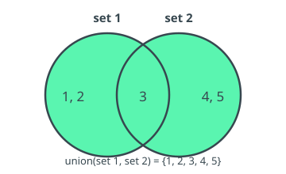
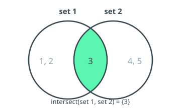
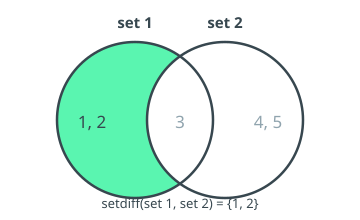
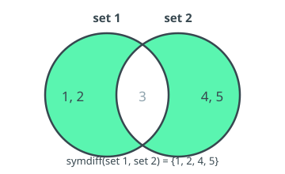

# 13 Set Operators

Set *Operators* construct and combine *Scalar Sets* (see §2.2.2). A *Scalar Set* is an unordered, duplicate-free collection of *Scalar* values that share a single *Data Type*. Until now, *Scalar Sets* could only be written as literals (`{v1, v2, ...}`, or `{}` for the empty set) or obtained from a *Subcategory*, and were consumed only by the `in` *Operator* (§5.8). The *Operators* in this section make *Scalar Sets* first-class:

- **`set_of`** derives a *Scalar Set* from the *Fact Component* of a *Recordset*.
- **`union`**, **`intersect`**, **`setdiff`** and **`symdiff`** combine *Scalar Sets*.

The cardinality of a *Scalar Set* (its number of distinct elements) is obtained with the `count` *Operator* (§7.3), which accepts a `scalar_set` in addition to a *Recordset*.

Each combining *Operator* (`union`, `intersect`, `setdiff`, `symdiff`) is illustrated below with a Venn diagram of two example sets, `set 1 = {1, 2, 3}` and `set 2 = {3, 4, 5}`, in which the shaded region marks the elements that end up in the result.

A set-valued expression — a literal, a *Subcategory*, a `set-*` *Parameter*, or the result of any *Operator* in this section — may appear as the right-hand side of `in`, as the *Operand* of `count`, as an *Operand* of the binary and variadic set *Operators* (so they nest freely, e.g. `union(set_of(A), setdiff(B, C))`), and as an *Operand* of the equality *Operators* `=` and `!=` (see [Set Equality](#137-set-equality)).

Where a set *Operand* is written as a *Recordset* or *Subcategory* selection, it is implicitly read as the *Scalar Set* of its values — equivalent to wrapping it in `set_of` (§13.2). So `union({tC_28.00, c020}[get qINC], {tC_29.00, c0030}[get qINC])` is accepted directly, without an explicit `set_of` around each selection.

These are **semantic** rules, not syntactic ones: the grammar accepts an ordinary expression in every set position, and semantic analysis is responsible for the type restrictions. In particular, set-valued expressions are **not** *Scalars* or *Recordsets*, so — apart from set equality — they cannot be combined with scalar/recordset *Operators*: arithmetic and the ordering comparisons (`<`, `>`, `<=`, `>=`) are not defined on *Scalar Sets*, and a comparison such as `{c020} = setdiff(A, B)` (a *Recordset* against a *Scalar Set*) is rejected by semantic analysis even though it parses.

## 13.1 Set Operators' General Behaviour

### 13.1.1 Syntax

> **setOperator (** s1, s2 {, s3}\* **)**

### 13.1.2 Input Parameters

> s1, s2, ...: scalar_set <*> | subcategory | rset <*>

### 13.1.3 Output

> scalar_set <T\>

### 13.1.4 Semantics
The binary and variadic set *Operators* combine their *Operands* into a new *Scalar Set*. Membership is decided element-wise using the equality *Operator* (`=`), so two elements are "the same" exactly when they compare equal under `=`; for intervals, this inherits the interval semantics of `=` (see §5.2). The result is always a *Scalar Set*: unordered and duplicate-free.

### 13.1.5 Additional Constraints

- All elements within a *Scalar Set* must share a single *Data Type*, considering implicit casting.
- For a binary or variadic set *Operator*, the *Operands* must have compatible element *Data Types*. The element *Data Type* of the result is the maximum common *Data Type* of the *Operands*, determined by the implicit casting hierarchy (§2.3.2) — e.g. combining an Integer set with a Number set yields a Number set.
- A *Subcategory* *Operand* is implicitly treated as a *Scalar Set* of its member items, consistently with the `in` *Operator* (§5.8).
- A *Recordset* *Operand* is implicitly treated as the *Scalar Set* of its *Fact Component* values, exactly as if wrapped in `set_of` (§13.2). To take the set of a *Key* or *Attribute Component* instead, move it into the *Fact* first with the [get](./11-clause-operators.md#113-get) clause — e.g. `union(A[get CNT], B[get CNT])`.
- `null` is **not** a valid set element. Set *Operators* never introduce `null`; any `null` arising at construction time (e.g. from `set_of`) is dropped.

### 13.1.6 Behaviour
Set *Operators* operate purely on the values of their *Operands*; they do not carry *Key* or *Attribute Components*, since their result is a *Scalar Set*, not a *Recordset*. The result contains each distinct value at most once.

## 13.2 Set of (set_of)

### 13.2.1 Syntax

> **set_of(** op **)**

### 13.2.2 Input Parameters

> op: rset <*\>

### 13.2.3 Output

> scalar_set <T\> — where T is the *Data Type* of the *Fact Component* of op.

### 13.2.4 Semantics
Returns the *Scalar Set* of distinct, non-null values taken by the *Fact Component* across the *Records* of op.

To obtain the set of values of a *Key* or *Attribute Component*, first move that *Component* into the *Fact* with the [get](./11-clause-operators.md#113-get) clause *Operator*, then apply `set_of` — e.g. `set_of(op[get CNT])`.

### 13.2.5 Additional Constraints
None.

### 13.2.6 Behaviour
Each *Record* of op contributes its *Fact* value. Duplicate values collapse to a single element, and *Records* whose *Fact* value is `null` contribute nothing. The result is a *Scalar Set* whose element *Data Type* is that of the *Fact Component* of op.

### 13.2.7 Examples
Considering the following *Recordset*, generated from the selection `{tT1, r010-020}`:

| refPeriod {#k} | r {#k} | CNT {#k} | f {#f} |
|--------------|--------|----------|--------|
| 2022Q1       | 010    | ES       | 100    |
| 2022Q1       | 010    | PT       | 200    |
| 2022Q1       | 010    | DE       | 300    |
| 2022Q1       | 010    | IT       | 400    |
| 2022Q2       | 020    | ES       | 500    |
| 2022Q2       | 020    | PT       | 600    |
| 2022Q2       | 020    | DE       | 700    |
| 2022Q2       | 020    | IT       | 800    |

`set_of({tT1, r010-020})` results in `{100, 200, 300, 400, 500, 600, 700, 800}` — the distinct *Fact* values.

`set_of({tT1, r010-020}[get CNT])` results in `{"ES", "PT", "DE", "IT"}` — the `get` clause first moves `CNT` into the *Fact*.

## 13.3 Union (union)

### 13.3.1 Syntax

> **union(** s1, s2 {, s3}\* **)**

### 13.3.2 Input Parameters

> s1, s2, ...: scalar_set <*> | subcategory

### 13.3.3 Output

> scalar_set <T\>

### 13.3.4 Semantics
Returns the *Scalar Set* of elements present in **any** of the *Operands*. `union` accepts two or more *Operands*.

### 13.3.5 Additional Constraints

- [Set *Operators*' general behaviour](#131-set-operators-general-behaviour).

### 13.3.6 Behaviour

- [Set *Operators*' general behaviour](#131-set-operators-general-behaviour).

### 13.3.7 Examples

- `union({1, 2, 3}, {3, 4, 5})` results in `{1, 2, 3, 4, 5}`.
- `union({1}, {2}, {3})` results in `{1, 2, 3}`.

## 13.4 Intersection (intersect)

### 13.4.1 Syntax

> **intersect(** s1, s2 {, s3}\* **)**

### 13.4.2 Input Parameters

> s1, s2, ...: scalar_set <*> | subcategory

### 13.4.3 Output

> scalar_set <T\>

### 13.4.4 Semantics
Returns the *Scalar Set* of elements present in **all** of the *Operands*. `intersect` accepts two or more *Operands*.

### 13.4.5 Additional Constraints

- [Set *Operators*' general behaviour](#131-set-operators-general-behaviour).

### 13.4.6 Behaviour

- [Set *Operators*' general behaviour](#131-set-operators-general-behaviour).

### 13.4.7 Examples

- `intersect({1, 2, 3}, {3, 4, 5})` results in `{3}`.
- `intersect({1, 2, 3}, {2, 3, 4}, {3, 4, 5})` results in `{3}`.

## 13.5 Set Difference (setdiff)

### 13.5.1 Syntax

> **setdiff(** s1, s2 **)**

### 13.5.2 Input Parameters

> s1, s2: scalar_set <*> | subcategory

### 13.5.3 Output

> scalar_set <T\>

### 13.5.4 Semantics
Returns the *Scalar Set* of elements in `s1` that are **not** in `s2`. `setdiff` is binary and **not** symmetric: the order of the *Operands* matters.

### 13.5.5 Additional Constraints

- [Set *Operators*' general behaviour](#131-set-operators-general-behaviour).

### 13.5.6 Behaviour

- [Set *Operators*' general behaviour](#131-set-operators-general-behaviour).

### 13.5.7 Examples

- `setdiff({1, 2, 3}, {3, 4, 5})` results in `{1, 2}`.
- `setdiff({3, 4, 5}, {1, 2, 3})` results in `{4, 5}`.

## 13.6 Symmetric Difference (symdiff)

### 13.6.1 Syntax

> **symdiff(** s1, s2 **)**

### 13.6.2 Input Parameters

> s1, s2: scalar_set <*> | subcategory

### 13.6.3 Output

> scalar_set <T\>

### 13.6.4 Semantics
Returns the *Scalar Set* of elements in **exactly one** of `s1` or `s2` — equivalently, `setdiff(union(s1, s2), intersect(s1, s2))`. `symdiff` is binary and symmetric.

### 13.6.5 Additional Constraints

- [Set *Operators*' general behaviour](#131-set-operators-general-behaviour).

### 13.6.6 Behaviour

- [Set *Operators*' general behaviour](#131-set-operators-general-behaviour).

### 13.6.7 Examples

- `symdiff({1, 2, 3}, {3, 4, 5})` results in `{1, 2, 4, 5}`.
- `symdiff({1, 2}, {1, 2})` results in `{}` (the empty set).

## 13.7 Set Equality (=, !=)

The equality *Operators* `=` and `!=` accept two set-valued *Operands* and compare them as *Scalar Sets*, returning a single Boolean. This is the only comparison defined on *Scalar Sets*: the ordering *Operators* (`<`, `>`, `<=`, `>=`) and the arithmetic *Operators* are **not** defined on sets.

### 13.7.1 Syntax

> s1 **=** s2
>
> s1 **!=** s2

### 13.7.2 Input Parameters

> s1, s2: scalar_set <*> | subcategory

### 13.7.3 Output

> scal <boo\>

### 13.7.4 Semantics
`s1 = s2` returns `true` when the two *Scalar Sets* contain exactly the same elements — every element of `s1` is in `s2` and every element of `s2` is in `s1` — and `false` otherwise. `s1 != s2` is its negation. Membership is decided with the same element-wise equality as the other set *Operators* (§13.1.4); order and duplicates are irrelevant, since both *Operands* are *Scalar Sets*.

The empty set is written `{}`. Comparing against it tests emptiness: `s = {}` is `true` exactly when `s` has no elements.

### 13.7.5 Additional Constraints

- The two *Operands* must have compatible element *Data Types*, following the same rule as the combining set *Operators* (§13.1.5).
- Set equality applies when **both** *Operands* are set-valued (a set literal, a set *Operator* result, a `set-*` *Parameter*, or a *Subcategory*). When both *Operands* are instead *Scalars* or *Recordsets*, `=` and `!=` denote the ordinary [comparison](./05-comparison-operators.md#52-equal) (§5.2, §5.3); a comparison that mixes a *Scalar Set* with a *Scalar* or *Recordset* is rejected by semantic analysis. The grammar does not distinguish these cases — the choice is made from the *Operand* types. For instance, `{c020} = {c030}` is a *Recordset* comparison when `c020`/`c030` are ordinary *Recordset* selections; wrap an *Operand* in `set_of` (or use a set literal or set *Operator*) to make the comparison set-valued.

### 13.7.6 Behaviour
Both *Operands* are evaluated to *Scalar Sets* and compared by value; the result is a single Boolean *Scalar*.

### 13.7.7 Examples

- `{1, 2, 3} = {3, 2, 1}` results in `true` (order does not matter).
- `{1, 2} = {1, 2, 3}` results in `false`.
- `symdiff({1, 2}, {1, 2}) = {}` results in `true` (equal sets have an empty symmetric difference).
- `setdiff({tT1, r010}[get CNT], {tT2, r020}[get CNT]) = {}` results in `true` when every `CNT` value of the first selection also appears in the second — i.e. the first set is a subset of the second. Each selection is coerced to its *Scalar Set* (§13.1.5), so no explicit `set_of` is needed.
